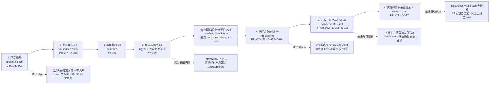
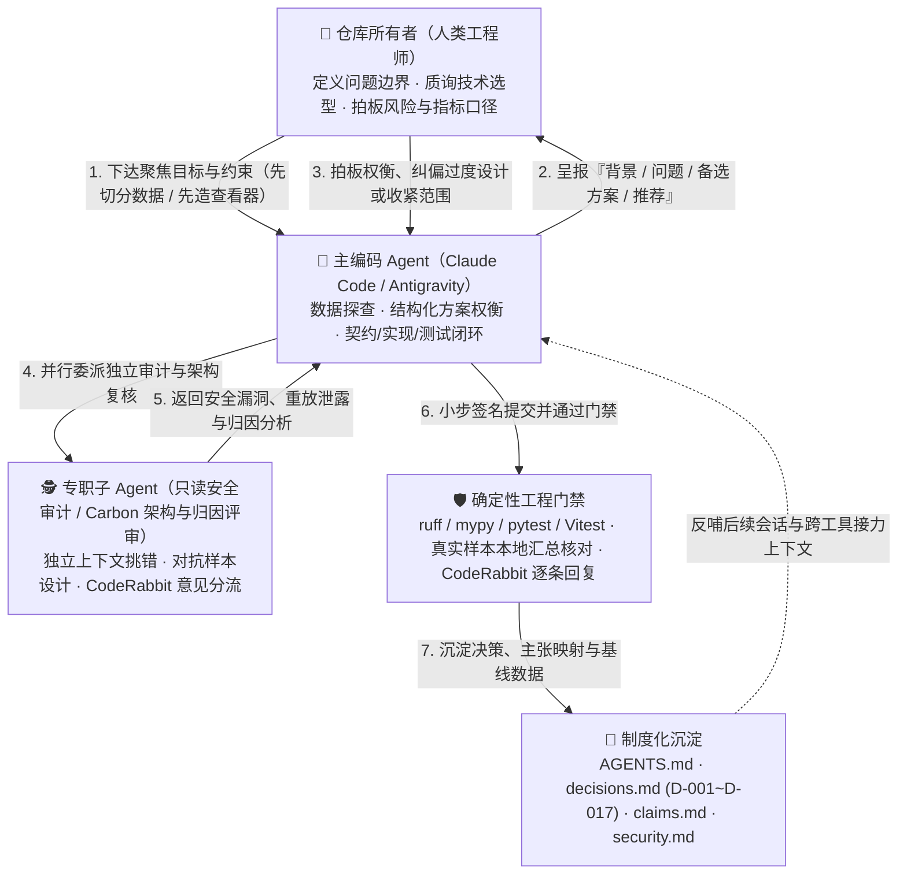
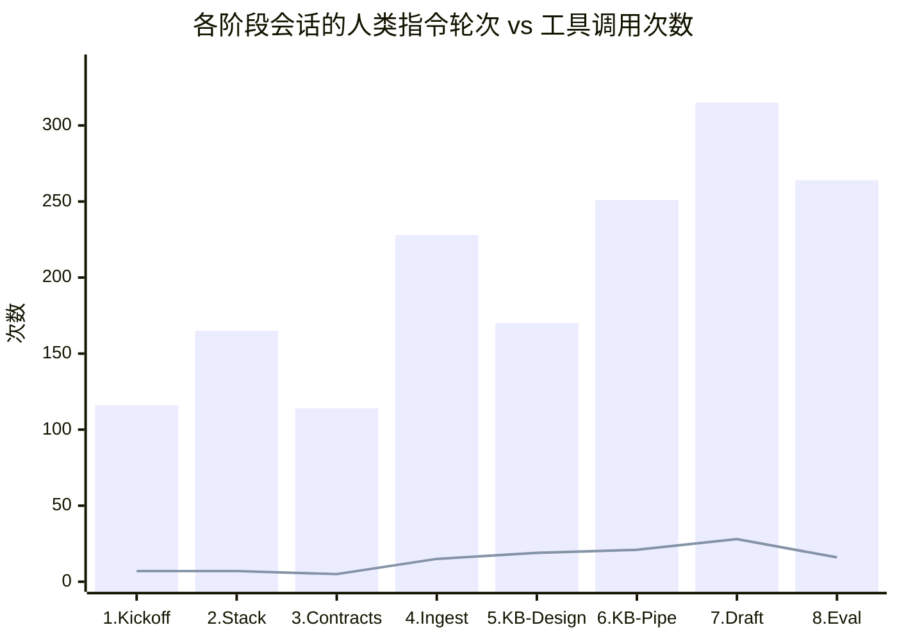

# AI 协作工程实践与会话记录导读

本文档是实践测试题（[`docs/requirements.md`](../docs/requirements.md)）交付物 **C（AI 协作过程）** 的总览与导读，配套 [`agent-conversations/`](README.md) 目录下的 8 份原始协作会话记录（完整技术方案复盘见交付物 B [`docs/approach.md`](../docs/approach.md)）。下文依次说明会话导出与脱敏机制、交互式 HTML 审阅器的使用方法，并通过架构演进图与原始对话摘录复盘人机协作完成『ぽちゃガチョ！』客服坐席助手（Copilot）工程落地的全过程。

---

## 1. 概览：从空白仓库到可评测系统的协作全貌

本项目从最初阅读题目说明（[`docs/requirements.md`](../docs/requirements.md)）与样本表格开始，就确立了以真实可维护工程标准推进的原则（[`docs/decisions.md`](../docs/decisions.md) D-001～D-009）：每次关键开发会话结束时，将结构化的原始人机交互记录归档至 `agent-conversations/`（D-009），不事后编造或粉饰对话。

8 份会话完整覆盖了从项目启动、技术栈论证、数据契约、清洗入库、时间感知知识库、检索起草与安全目录，到离线评测与模型校准的全部核心阶段：

| 序号 | 会话文件 | 工具环境 | 人类指令 | Agent 回复 | 工具调用 | 关联 Issue / PR / 决策 |
|---:|---|---|---:|---:|---:|---|
| 1 | [`2026-11-26-project-kickoff.json`](2026-11-26-project-kickoff.json) | Claude Code | 7 | 38 | 116 | Issue #1–#13 · D-001～D-009 |
| 2 | [`2026-11-26-foundation-stack.json`](2026-11-26-foundation-stack.json) | Claude Code | 7 | 89 | 165 | Issue #2, #14 · PR #15 · D-010 |
| 3 | [`2026-11-26-contracts.json`](2026-11-26-contracts.json) | Claude Code | 5 | 39 | 114 | Issue #3, #13, #14 · PR #16 |
| 4 | [`2026-11-26-ingest.json`](2026-11-26-ingest.json) | Claude Code | 15 | 111 | 228 | Issue #4, #18 · PR #17 |
| 5 | [`2026-11-26-kb-design-contracts.json`](2026-11-26-kb-design-contracts.json) | Claude Code | 19 | 82 | 170 | 提案 0003, Issue #19 · PR #20–#21 · D-011 |
| 6 | [`2026-11-27-kb-pipeline.json`](2026-11-27-kb-pipeline.json) | Claude Code | 21 | 121 | 251 | Issue #5 · PR #22–#27 · D-012～D-014 |
| 7 | [`2026-11-27-issue-6-draft.json`](2026-11-27-issue-6-draft.json) | Claude Code | 28 | 123 | 315 | Issue #6, #31 · PR #28–#32 · D-015～D-016 |
| 8 | [`2026-11-27-issue-7-eval.json`](2026-11-27-issue-7-eval.json) | Antigravity | 16 | 0* | 264 | Issue #7, #34, #35 · PR #33 · D-017 |
| **合计** | **8 份会话** | **双工具接力** | **118** | **603** | **1,623** | **19 个合并 PR · D-001～D-017** |

> 注（\*）：上表「人类指令」已剔除 `/clear`、`<task-notification>` 等 22 条运行环境噪音轮次与 1 条直接终端命令（原始 `turns` 总数为 141）。第 8 份会话由 Antigravity 导出，其结构差异见第 2.2 节；后续中文坐席工作台（#8，PR #38，D-018～D-019）与方案复盘（#9，PR #39）在同一工程规范下继续推进并合入 `main`。

---

## 2. 会话记录的导出、脱敏与双语增强

### 2.1 自动化导出与严格脱敏规则

客户样本数据虽经初步脱敏，仍属于客户资产且包含真实玩家咨询上下文（D-002）；开发过程中也会涉及本地路径、SSH 签名密钥与第三方评审令牌（D-005）。为此，仓库编写了确定性导出脚本 [`scripts/export_claude_session.py`](../scripts/export_claude_session.py)，在将原始 JSONL 转换为 `schema_version: 1` 结构化 JSON 时执行三层过滤：

1. **防样本数据泄露（Data Leak Prevention）**：凡是 `Bash` 命令输入命中数据特征词（`.xlsx`、`data/interim`、`.jsonl`、`threads.json`、`sharedStrings` 等），或 `Read` 工具读取持久化的长输出目录（`tool-results/`），工具输出一律整段替换为 `[输出包含样本数据片段，按 data/README.md 的规则省略]`。导出后仍结合人工抽检补漏（例如手动隐去真实样本上运行 `copilot draft` 的单条草稿回显）。
2. **凭据与个人信息隐去（PII & Secret Redaction）**：自动隐去邮箱地址、本地用户名与主目录（替换为 `~`、`<user>`、`$SCRATCHPAD`）、SSH 公钥与指纹、GitHub/CodeRabbit 访问令牌（如 `ghh_…`）以及报错 URL 中的组织 ID。
3. **信噪比控制（Signal-to-Noise）**：省略模型内部思考过程（thinking blocks）、`<system-reminder>` 系统注入提示以及 `Write` 工具写入文件的完整正文（文件最终内容以 Git 历史为准）；常规工具输出保留前 40 行（`Read`/`Write`/`Edit` 保留前 3 行），单字段上限 4,000 字符。

### 2.2 Claude Code 与 Antigravity 的导出差异

本仓库刻意保持工具无关（[`AGENTS.md`](../AGENTS.md) 第 2 节、D-004）。前 7 份会话在 **Claude Code** 中完成，第 8 份离线评测会话（[`2026-11-27-issue-7-eval.json`](2026-11-27-issue-7-eval.json)）切换到 **Antigravity**（并编排 Gemini Carbon 子 Agent 协同架构评审与归因分析）。两者的 JSON 顶层 schema 完全兼容，但步骤粒度存在一项客观差异：

| 维度 | Claude Code 导出（前 7 份） | Antigravity 导出（`issue-7-eval.json`） |
|---|---|---|
| 人类指令（`turn.user`） | 完整保留（含少量 `/clear`、`<task-notification>` 环境包装消息） | 完整保留全部 16 轮人类调度指令，无环境噪音轮次 |
| Agent 文本回复（`agent_message`） | 完整保留每轮分析、方案权衡与汇报正文（共 603 条） | **0 条**（导出器未单独切分自由文本回复块） |
| 工具调用（`tool_call`） | 保留工具名（`Bash`/`Edit`/`Write`/`Read`）、描述、脱敏输入与截断输出 | 保留全部 264 次工具调用时序轨迹（`run_command` ×73、`edit_file` ×69、`read_file` ×49、`update_focus` ×32 等），输入与输出置空以防评测派生样本外泄 |

### 2.3 原文零改动的中文翻译字段 `translation_chs`

实际编码协作中，仓库所有者主要使用简短、高密度的英文向 Agent 下达指令（便于贴合代码标识符与 CLI 语境）。为遵循仓库中文文档规范（D-008）并方便中文审阅者快速阅读，我们在**不改动任何原始字段（`user`、`text`、`tool_call` 等字节级保持不变）**的前提下，为全部 8 份会话注入了同级 `translation_chs` 字段：

- **覆盖范围 100%**：覆盖全部 **118 条**实质性人类 Prompt（`turn.translation_chs`）与全部 **603 条** Agent 回复（`step.translation_chs`），共计 **721 段**简体中文译文。
- **技术保真**：保留原始 Markdown 层级、表格、代码块、文件路径、命令参数、Git SHA、Issue/PR 编号以及日语客服模板原文不译，仅将英文工程叙述译为自然的中文技术表达。

---

## 3. 使用 HTML 审阅器浏览会话

原始会话 JSON 体量较大（单文件最高逾 300 次工具调用），直接阅读原始 JSON 容易被大量终端命令淹没重点。仓库提供了零外部依赖的前端审阅器 [`agent-conversations/viewer.html`](viewer.html) 与仅使用 Python 标准库的辅助脚本 [`scripts/render_conversations.py`](../scripts/render_conversations.py)。

### 3.1 三种打开方式

```sh
# 方式 1：启动本地 HTTP 预览服务器（推荐，自动加载全部 8 份会话）
python3 scripts/render_conversations.py --serve --open

# 方式 2：打包为单个离线 HTML 文件（无任何网络依赖，可直接双击或随压缩包分发）
python3 scripts/render_conversations.py --bundle -o /tmp/conversations-bundle.html

# 也可以单独将某一份会话渲染为独立 HTML
python3 scripts/render_conversations.py agent-conversations/2026-11-26-project-kickoff.json -o /tmp/kickoff.html
```

**方式 3（纯静态免命令行）**：直接用浏览器双击打开 [`agent-conversations/viewer.html`](viewer.html)，将 `agent-conversations/*.json` 拖拽进页面虚线框，或点击右上角 **「📂 打开 JSON」** 多选加载（绕过浏览器 `file://` 协议的同源读取限制）。

### 3.2 核心审阅功能

- **🌐 中英双语切换与单条对照**：顶部工具栏默认开启 **「显示中文」**（优先渲染 `translation_chs`，缺失时自动回退原文）；每张消息卡片右上角均附有 **「对照英文原文 / 对照中文译文」** 按钮，可一键展开原文逐句核对。
- **🔧 连续工具调用折叠审计**：默认将每轮连续的 `tool_call` 折叠为单行紧凑摘要条（例如 `已折叠 11 次工具调用 · Bash ×8 · Edit ×2 · Read ×1`，含错误高亮提示），突出「人类决策 ↔ Agent 方案汇报」主线；需要核查具体命令或输出时点击即可逐层展开，也可通过顶部开关全局展开。
- **🧹 运行环境噪音过滤**：默认折叠隐藏 `/clear`、`<local-command-caveat>`、`<task-notification>`、用户中断标记等非实质性环境消息，并以虚线胶囊提示隐藏数量，点击即可随时还原。
- **💡 跨工具结构自适应**：切换到 `2026-11-27-issue-7-eval.json` 时，自动展示 Antigravity 导出说明横幅，并以紧凑单行时序列表呈现 264 次工具调用轨迹，不产生空白回复气泡。
- **🔍 全文检索与轮次跳转**：支持同时检索中文译文、英文原文与工具描述，左侧边栏实时显示各会话命中数及当前会话轮次大纲（支持 `#<文件名>:turn-<N>` 锚点定位）。

---

## 4. 工程推进方法论与全景图

### 4.1 研发演进与架构决策路线图

整个项目并非一次性让 AI“生成全部代码”，而是严格沿着 **「治理先行 → 契约锁定 → 确定性清洗 → 时间与信任建模 → 防泄露切分与知识库 → 分流起草与安全编目 → 离线评测闭环」** 的工程依赖链推进，每一步的取舍均沉淀为不可篡改的决策记录（`D-001`～`D-017`）：



### 4.2 人机协同控制环（Human-Agent Control Loop）

纵观 8 份会话，人类工程师始终掌握**架构边界、信任假设、范围纪律与指标诚实度**四项不可外包的决策权，同时将代码落地、一次性探查工具构建、对抗性安全审计与自动化评审处理高效委派给主 Agent 与专职子 Agent：



### 4.3 会话规模与工程产出杠杆

仅用 **118 轮**清晰聚焦的人类指令，驱动 Agent 完成了 **1,623 次**工具操作，在两天内交付了具备完整类型契约、双工具链 CI、版本化知识库、混合检索起草流水线（12,860 行后端代码 + 8,451 行测试代码，共 131 个 Python 模块）以及 39 项端到端安全重放的完整系统：



> 柱状图为每份会话的 Agent `tool_call` 执行次数（总计 1,623 次），折线为实质性人类指令轮次（总计 118 轮），平均每轮人类指令撬动约 **13.8 次**受控工具执行。

---

## 5. 关键工程能力与原始对话摘录

以下按七个工程维度摘录原始会话中的代表性片段。每处摘录均标明对应的会话文件与轮次编号（可在 [`viewer.html`](viewer.html) 中直接定位核对），同时保留英文原文与 `translation_chs` 中文译文。

### 5.1 工程治理与工具无关的协作规范

项目启动伊始，没有急于堆砌业务代码，而是先把「多工具兼容的 Agent 指南」「私有仓库下的软性分支保护」「受众语言规范」和「结构化协作日志格式」固化为仓库基础设施：

- **建立工具无关的 `AGENTS.md` + 符号链接机制（兼顾 Windows 局限）** — [`2026-11-26-project-kickoff.json`](2026-11-26-project-kickoff.json) · **Turn #3**：
  > **Original**: *"For other devs, do not assume their agents. make a universal AGENTS.md and .agents/ to put skills, and in AGENTS.md, instruct agents to discover and symlink their looking directory if possible. We should create symlinks, but it is known to be problematic on windows machines, so it is a best-effort approach."*
  >
  > **中文译文**：对于其他开发者，不要假设他们用什么 Agent。建立一个通用的 `AGENTS.md` 和 `.agents/` 目录来放技能，并在 `AGENTS.md` 中指导 Agent 自行发现并尽量通过符号链接（symlink）把它们各自读取配置的位置指过去。我们应该创建符号链接，但已知这在 Windows 机器上容易出问题，所以采用尽力而为（best-effort）策略。
  - **落地效果**：沉淀为 D-002、D-003、D-004，避免了常见的 `CLAUDE.md` / `GEMINI.md` 多份复制漂移问题；后续会话切换到 `agy` 与 Antigravity 时零摩擦复用同一套仓库规则与技能。

- **敏锐纠正受众语言偏差，确立中文工程规范** — [`2026-11-26-project-kickoff.json`](2026-11-26-project-kickoff.json) · **Turn #4**：
  > **Original**: *"I noticed you used English in README.md and I think we have missed the point that the other devs are Chinese. So we should append a rule: Documentation should stay in Chinese, as well as PRs, Issues and code comments. And I think we should not add /docs/ai-log yet, that will be deferred until the end of this test."*
  >
  > **中文译文**：我注意到你在 README.md 里用了英文，我觉得我们忽略了其他开发者都是中文母语者这一点。所以我们应该补充一条规则：文档、PR、Issue 和代码注释都应使用中文。另外我认为现在先不要加 `/docs/ai-log`，这部分延后到测试结束时再整理。
  - **落地效果**：形成 D-007 与 D-008，明确了代码标识符、通用术语与日语原文保留、其余全部使用简体中文的边界。

- **审视导出可读性，要求改为边界清晰的结构化 JSON** — [`2026-11-26-project-kickoff.json`](2026-11-26-project-kickoff.json) · **Turn #8**：
  > **Original**: *"i looked at the exported conversation and i think it is kind of hard to read. Please export the conversation in json, so it is clear that where the user message, tool calls and agent messages boundaries"*
  >
  > **中文译文**：我看了一下导出的对话，觉得有点难读。请把对话导出成 JSON，这样就能清晰看出用户消息、工具调用和 Agent 消息之间的边界。
  - **落地效果**：催生了 D-009 与 [`scripts/export_claude_session.py`](../scripts/export_claude_session.py) 的 `schema_version: 1` 格式，为今天构建结构化折叠渲染器奠定了数据基础。

---

### 5.2 技术选型第一性原理与解耦设计

面对 Agent 起草的基础建设提案（#2），仓库所有者从第一性原理连续追问五个核心维度，否定了绑定单一模型供应商与前后端紧耦合方案：

- **五连问质询技术栈，坚决拒绝绑定单一 LLM 服务商** — [`2026-11-26-foundation-stack.json`](2026-11-26-foundation-stack.json) · **Turn #3**：
  > **Original**: *"1. why FastAPI and python? Compared to Django or Flask, and maybe Rust backend? 2. why not introduce a frontend framework? 3. for db, why sqlite instead of pgvector or chroma? 4. LLM part is what i object the most. We should not assume provider. We should support any openai-compatiable endpoint as provider. 5. for testing, what and how are we going to test?"*
  >
  > **中文译文**：1. 为什么选 FastAPI 和 Python？与 Django 或 Flask，或者 Rust 后端相比有什么考量？2. 为什么不引入前端框架？3. 数据库方面，为什么选 SQLite 而不是 pgvector 或 Chroma？4. LLM 部分是我最反对的地方。我们不应该预设供应商，而应该支持任何 OpenAI 兼容端点作为供应商。5. 测试方面，我们要测什么、怎么测？

- **确立 REST 前后端分离、存储接口抽象、合成数据 CI + 真实数据本地核验，并兼顾无 `uv`/`pnpm` 备用路线** — [`2026-11-26-foundation-stack.json`](2026-11-26-foundation-stack.json) · **Turn #4 & Turn #5**：
  > **Original (Turn #4)**: *"for 2, i think we should introduce React because it will not be that heavy to add one, and is a clear seperation of concerns if we let two services talk through a REST API which can also lay foundation on later interation, so it is an easy win. 3 itself is sound, but we should reserve interfaces should the load of the system becomes heavy in future and we need to migrate database implementation. In MVP phase, keep SQLite is sane."*
  >
  > **中文译文（Turn #4）**：关于第 2 点，我觉得应该引入 React，因为加上它并不会太重，而且让两个服务通过 REST API 通信能够清晰地分离关注点，也能为后续迭代打下基础，算是一举两得。第 3 点本身很合理，不过如果未来系统负载变重、需要迁移数据库实现，我们应该预留好接口。在 MVP 阶段，继续用 SQLite 是明智的。
  - **落地效果**：沉淀为 D-010（PR #15）及部署 Issue #14。其中「按任务解耦任意 OpenAI 兼容端点」这一决策在 #5 与 #7 中发挥了决定性作用——团队得以零代码重构接入 OpenRouter，用 Opus 5.5 担任固定评审模型（Judge），并在 Gemini 4 与 DeepSeek v4.1 Flash 之间完成低成本横向对照实验。

---

### 5.3 数据直觉与时间感知的领域建模

进入数据清洗（#4）前，不盲目写解析规则，而是先造工具目检真实邮件线程，并由此洞察出客服知识库最核心的**时间维度**与**系统退信歧义**：

- **写流水线前先造本地线程查看器目检原始数据** — [`2026-11-26-ingest.json`](2026-11-26-ingest.json) · **Turn #3**：
  > **Original**: *"#4. before you start, please build me a local-only react based renderer that interpert the roughly cleaned email data into reply threads indexed by case id, so i can inspect data and see what are they like."*
  >
  > **中文译文**：#4。动手之前，先帮我搭一个只在本地跑的 React 渲染器，把粗略清洗过的邮件数据按案件 ID 解析成回复线程，让我能直接看数据、看看它们长什么样。

- **提出精确到分钟的历史时间模拟，拆分恒定事实与限时公告** — [`2026-11-26-ingest.json`](2026-11-26-ingest.json) · **Turn #5 & Turn #6**：
  > **Original (Turn #5)**: *"Also because we are benchmarking the system in historical context, we will also need to prentend that the event mentioned is happening, and provide agents with time context. The granularity should be exact to minutes, and time context is appended at the end of the query to the LLM."*
  >
  > **中文译文（Turn #5）**：另外因为我们要在历史语境里给系统做基准测试，还需要假装当时提到的那个事件正在发生，并给 Agent 提供时间上下文。粒度要精确到分钟，时间上下文附在发给 LLM 的查询末尾。
  - **落地效果**：直接启发了[提案 0003](../docs/proposals/0003-knowledge-base.md) 与 D-011 的核心设计——所有知识条目带现实有效期与 `known_from`（历史重放绝不能看到未来才写出的修正），时间状态显式区分「已知 / 估计区间 / 未知」。

- **严谨拆解系统邮件（`S`）的三种可能成因，避免误判结案污染知识库** — [`2026-11-26-ingest.json`](2026-11-26-ingest.json) · **Turn #15**：
  > **Original**: *"for the sake of the knowledge base, I think wether the thread ends on a system message by itself is not a good indicator, because: - a bounce may be our system fail to send outgoing reply - it maybe player copypaste malformed context into their message - it maybe malicious paylod trying to disguise as system ... If a thread is left on S, then it would need semantic to analyze if the case is closed."*
  >
  > **中文译文**：从知识库的角度看，线程是不是以系统消息结尾，本身不是个好指标，因为：退信可能是我们自己的系统没把回复发出去；也可能是玩家把格式错乱的上下文粘贴进了自己的消息；还可能是恶意载荷试图伪装成系统消息……如果线程停在 S 上，那就需要语义分析才能判断案件是否已关闭。
  - **落地效果**：修正了结案状态判定规则，将末尾为系统消息或缺乏强角色证据的线程统一标为 `undetermined`（真实样本中有 863 个线程从 `replied` 修正为 `undetermined`），交由 #6 的语义分析步骤处理，守住了 #4 纯确定性流水线的职责边界。

---

### 5.4 科学评测纪律与抗刷指标（Anti-Goodharting）

在构建知识库（#5）与运行离线评测（#7）时，始终把「防止评测集信息泄露」与「拒绝为了好看的数字放宽规则」放在首位：

- **未写知识库先做防泄露切分，并用时间均匀分层抽样保留「事件已结束」信号** — [`2026-11-27-kb-pipeline.json`](2026-11-27-kb-pipeline.json) · **Turn #1 & Turn #2**：
  > **Original (Turn #1)**: *"now implement #5. Before you go, I would like to ask you to think ahead and slice the data, so the part we select for the golden set is not leaked into the kb and the set remains indicative for system's perform evaluation"*
  >
  > **Original (Turn #2)**: *"go. My concern is split regarding the time will effectively block the system to learn the signal of "this event has ended", so I think a sampling that is uniform to time in distribution is a better fit."*
  >
  > **中文译文（Turn #1 & #2）**：现在开始实现 #5。动手之前，我想请你先往前想一步、把数据切好，这样我们挑出来做 golden set 的那部分就不会漏进 kb，这个集合也才能继续对系统表现评估有指示意义。……我的担心是：按时间切分实际上会让系统学不到“这个事件已经结束”这类信号，所以我觉得在时间分布上均匀的采样更合适。
  - **落地效果**：形成 D-012（`train` 70% / `dev` 15% / `test` 15% 时间均匀分层抽样，重复提交整组同侧，跨线程角色证据仅在 `train` 内重算，辅以 `known_from` 严格截断重放）。

- **面对 77.9% 模板覆盖率，拒绝凑够 80% 验收门槛** — [`2026-11-27-kb-pipeline.json`](2026-11-27-kb-pipeline.json) · **Turn #6**：
  > **Original**: *"I think I can accept 77.9%. 80% is like an ideal goal and should be persuited if we had access to harvest more data - but sadly this is already what we got at best, and there is no reason for us to just make the number pretty. We should do what we can to improve the system, not make numbers go big. If this makes sense to you, open PR and amend the number goal."*
  >
  > **中文译文**：我觉得 77.9% 可以接受。80% 更像一个理想目标，如果我们能采集到更多数据就该去追——但遗憾的是这已经是我们能拿到的最好结果了，我们也没有理由只把数字做得好看。该做的是尽我们所能改进系统，而不是把数字做大。如果你也认同，就开 PR 并把数字目标改掉。
  - **落地效果**：沉淀为 D-013（PR #23）。如果当时为了凑满 80% 而放宽角色证据要求，把 19% 弱证据回复纳入归纳，玩家伪造的回复就会混入模板库——这是典型的工程诚实胜过表面指标。

- **固定高阶 Judge 做受控模型对照，依据置信度分布拍板 `0.92` 自动发送阈值** — [`2026-11-27-issue-7-eval.json`](2026-11-27-issue-7-eval.json) · **Turn #6 & Turn #11**：
  > **Original (Turn #6)**: *"also do a controlled test with cheaper and faster models - like using Dpsk flash, judge stays as Opus 5.5"*
  >
  > **Original (Turn #11)**: *"i think 0.92 is the sweet spot under current config. Need to post the distribution in pr so the reasoning stays clear"*
  >
  > **中文译文（Turn #6 & #11）**：同时用更便宜、更快的模型做一次对照测试——例如使用 Dpsk flash，评判模型仍保持为 Opus 5.5。……我认为在当前配置下 0.92 是最佳平衡点。需要把分布情况发到 PR 里，让推理过程保持清晰。
  - **落地效果**：形成 D-017（PR #33），验证了 `deepseek/deepseek-v4.1-flash` 延迟降低约 32%、单案成本下降逾 20 倍且语体/安全/回译全项 100%，同时用跨模型校准分布将自动发送默认置信度阈值从 `0.85` 收紧至 `0.92`。

---

### 5.5 纵深安全防御与务实信任模型

客服系统直接暴露于外部不可信邮件输入，一旦被提示注入（Prompt Injection）或伪造历史回复攻破，可能导致错误承诺赔偿或污染知识库。团队在多个阶段构建了与项目阶段相匹配的纵深防御：

- **主动派独立子 Agent 对不可信输入流水线做安全审计** — [`2026-11-26-ingest.json`](2026-11-26-ingest.json) · **Turn #10 & Turn #12**：
  > **Original (Turn #10)**: *"cr still have some issues needs addressing. In the meantime, please start a subagent for a security audit: this pipeline handles untrusted user input"*
  >
  > **中文译文（Turn #10）**：cr 还有几个问题要处理。这期间请你起一个 subagent 做安全审计：这条流水线要处理不可信的用户输入。
  - **落地效果**：当场修复了正则 ReDoS、恶意构造 `.xlsx` 压缩炸弹与异常回显问题，并将提示注入防护作为最高优先级立项为 Issue #18。

- **清晰界定 MVP 人工审核信任根 vs 生产环境邮件元数据前提** — [`2026-11-26-kb-design-contracts.json`](2026-11-26-kb-design-contracts.json) · **Turn #11 & Turn #13**：
  > **Original (Turn #13)**: *"I would say that introducing my audit as the root trust of source sounds about sane - in the MVP stage. In prod we will need the metadata from mail server, so if we operate on that premise, then the risk level is acceptable, and we should not tug on the trust issue as of now."*
  >
  > **中文译文（Turn #13）**：我觉得把我的审核作为信任根源是合理的——在 MVP 阶段。到生产环境我们需要邮件服务器的元数据，所以只要我们按这个前提来做，风险水平是可以接受的，眼下不应该再在信任问题上反复拉扯。
  - **落地效果**：既防止了在无发件人元数据的文本上做无休止的启发式攻防内耗，又在架构上划定了红线——没有邮件服务器元数据时，知识库绝不根据新邮件自动更新（D-011）。

- **化繁为简的一票否决 12 关卡、`claims.md` 可证伪映射与「瑞士奶酪」攻击编目** — [`2026-11-27-issue-6-draft.json`](2026-11-27-issue-6-draft.json) · **Turn #14 & Turn #17**：
  > **Original (Turn #14)**: *"for 1 - i think you are over-complicating. Just make whatever function that initialze the auto send routine checks if the flow carrys approval from all 12 gates, so no combination test is required. Because it is designed to be fail one fail all ... 3. I agree. In readme and docs, we should list out our ciaims and assumptions explicitly, and clearly shows what claim is guarded by what test."*
  >
  > **Original (Turn #17)**: *"I think it will not worth it to patch every hole as of now, but we do need to document the possible attack patterns and replay them at #7, and catalogue them. The security model is morelike a layered cheese model, but we need to catalogue it so we know how and where to patch if the e2e test came back improvement needed"*
  >
  > **中文译文（Turn #14 & #17）**：关于 1：我觉得你想复杂了。就让初始化自动发送流程的那个函数去检查这条流程是否带着全部 12 道门槛的批准就行了，这样就不需要组合测试。因为它设计上就是一票否决……在 readme 和 docs 里，我们应该把主张和假设明确列出来，并清楚说明每条主张由哪个测试守着。……我觉得现在就把每个洞都补上不值得，但我们确实需要把可能的攻击模式记录下来，在 #7 里回放，并把它们编成目录。安全模型更像那种分层奶酪模型，但我们需要把它编目，这样当 e2e 测试回来说需要改进时，我们知道该补哪里、怎么补。
  - **落地效果**：避免了指数级爆炸的门槛组合测试，建立了 [`docs/claims.md`](../docs/claims.md)（每条安全与质量主张绑定具体单元测试或评测指标）与 [`docs/security.md`](../docs/security.md)（L1–L10 防御层与 `ATK-01`–`ATK-63` 攻击目录），并在 #7 中把全部 39 个合成攻击样本跑通端到端重放验证（见 [`docs/eval.md`](../docs/eval.md)）。

---

### 5.6 一次性人机回路提效工具（Disposable HITL Tooling）

当知识库流水线归纳出 82 个模板候选、需要人工逐一审核作为 MVP 信任根时，没有手动去改几十个 YAML 文件，而是让 Agent 现场构建一次性键盘审批页面：

- **几分钟构建方向键快速审批工具，完成全部 82 条模板人工审核** — [`2026-11-27-kb-pipeline.json`](2026-11-27-kb-pipeline.json) · **Turn #19**：
  > **Original**: *"build me a disposable data annotation tool, where you show me the template for approval on a page and i use left/right arrow keys to deny/approve a template, could be quick"*
  >
  > **中文译文**：帮我做一个一次性的数据审核工具：在一个页面上给我看模板让我决定，我用左右方向键来拒绝/通过，能快点做就行。
  - **落地效果**：Agent 即时启动本地审核服务（支持 `←` 拒绝、`→` 批准、`Z` 撤销，按覆盖率降序排列），仓库所有者在极短时间内高质量审完并批准全部模板，随后用完即删，不给代码库留维护负担。

---

### 5.7 多 Agent 编排、范围控制与跨工具无缝接力

在复杂长链路研发中，如何防止 Agent 表达混乱、越界施工或因配额中断丢失上下文，是人机协作的关键基本功：

- **要求清晰拆分「问题 / 方案 / 权衡」，并在越界苗头出现时立即拉回契约边界** — [`2026-11-26-kb-design-contracts.json`](2026-11-26-kb-design-contracts.json) · **Turn #4 & Turn #19**：
  > **Original (Turn #4)**: *"Your quesion comes confusing. Give me more context, and seperate cleanly between problem/your proposal/weigh options"*
  >
  > **Original (Turn #19)**: *"I just wanted to align what we are working on: #19, not actual knowledge base content and pipeline, because that would go to #5."*
  >
  > **中文译文（Turn #4 & #19）**：你的问题读起来很混乱。多给些上下文，把问题、你的提议、权衡选项清楚分开。……我只是想对齐一下我们在做什么：是 #19，不是真正的知识库内容和流水线，那些归 #5。

- **配额临近上限前主动要求撰写交接文档，实现跨工具接力** — [`2026-11-27-issue-6-draft.json`](2026-11-27-issue-6-draft.json) · **Turn #5**：
  > **Original**: *"The usage limit is almost up so please leave a stub handoff doc temporarily so i could let another llm take the remaining work. Please also archive this conversation"*
  >
  > **中文译文**：额度快用完了，所以请先临时留一份 stub 交接文档，好让我让另一个 llm 接手剩下的工作。另外也请把这段对话归档。

- **在评测阶段编排高阶子 Agent 负责架构复核、CodeRabbit 评审决策与修订后重跑基线** — [`2026-11-27-issue-7-eval.json`](2026-11-27-issue-7-eval.json) · **Turn #1–#2 & Turn #12–#13**：
  > **Original (Turn #2)**: *"after your first implementation run, ask a carbon agent to review your implementation architecture"*
  >
  > **Original (Turn #12 & #13)**: *"cr's comments are in. please let a carbon subagent handle them and give decisions"* → *"rerun baseline test with deepseek flash on revised test code to establish new harness"*
  >
  > **中文译文（Turn #2, #12 & #13）**：在首次实现运行之后，请让一个 carbon 代理审查你的实现架构。……cr 的评论已收到。请让一个 carbon 子代理处理这些评论并给出决策。……在修改后的测试代码上用 deepseek flash 重新运行基线测试，以建立新的评测基准。
  - **落地效果**：独立架构复核子 Agent 在首版评测代码上抓出了重放时间截断泄露与指标分母口径问题（提交 `a174171`），随后又完满处理了 CodeRabbit 的 13 条行内评审意见（`a297cc5`、`e106399`），并在最终修订后的评测框架上重新跑出了可复现的基线报告（`b4c2966`）。
