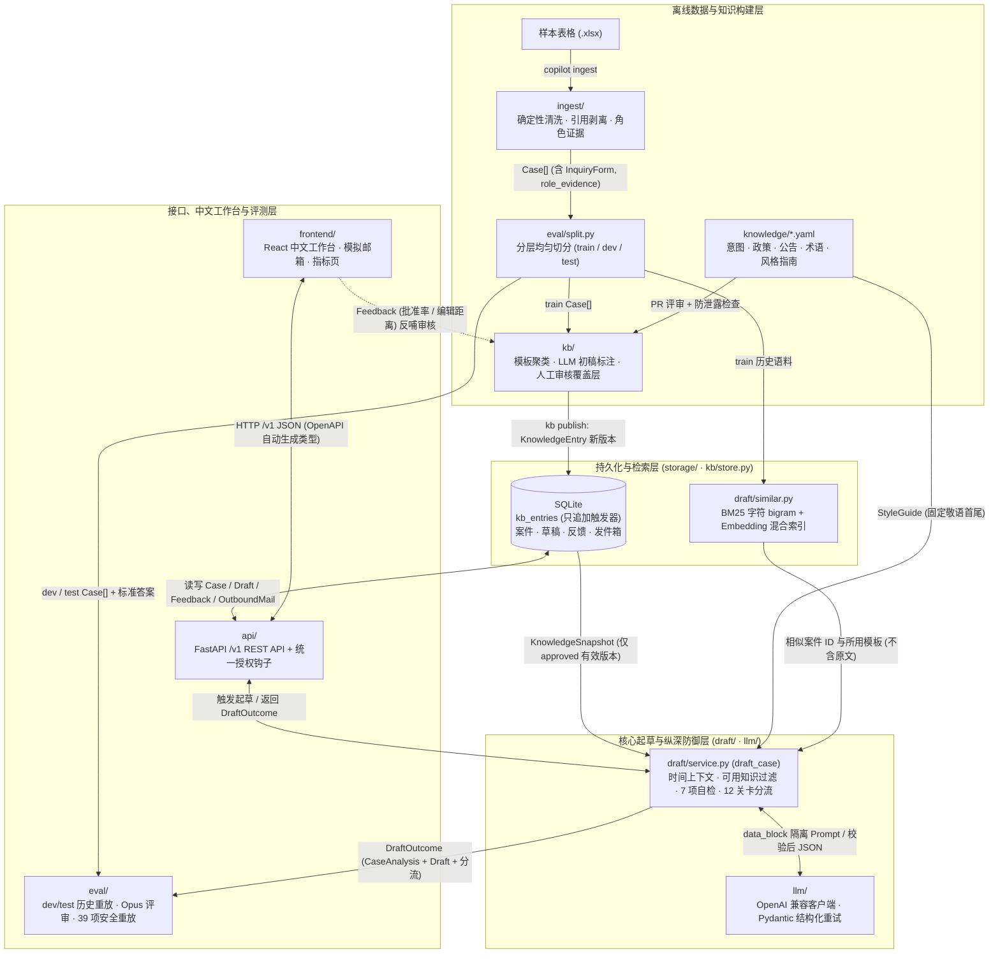
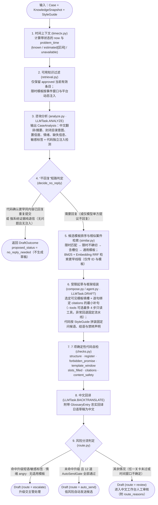

# 技术方案复盘（思路与架构总结）

本文是实践测试题（[requirements.md](requirements.md)）交付物 **B（思路复盘）** 的完整技术说明，面向从未看过开发会话的评审人与后续维护者（[D-006](decisions.md)）。文中所有统计均来自可复现的命令行产物（不含任何客户样本原文，[D-002](decisions.md)），评测指标与 [eval.md](eval.md) 严格一致。

---

## 1. 问题定义与核心取舍：为什么做坐席助手（D-001）

### 1.1 业务问题

手游『ぽちゃガチョ！』在日本发行，玩家邮件全部为日语，而客服团队由中文母语人员承担。系统需要同时解决三件事：

1. **跨语言理解与商务敬语表达**：让不懂日语的中文坐席准确理解玩家诉求，并输出符合日本手游客服惯例（固定寒暄、谦让语/尊敬语、禁止转载声明）的得体回复；
2. **基于小型历史知识库的精准回复**：利用约 5,950 封历史邮件沉淀出的官方答复口径，在特定故障窗口、平台差异和运营政策约束下给出准确方案，杜绝模型编造退款、补偿或修复日期；
3. **最大化自动化与可持续迭代**：在守住安全底线的前提下尽可能减少人工操作，并让每一次人工处理都能反哺知识库与分流策略。

### 1.2 为什么选择“人工在环的坐席助手”而非全自动回复

项目启动时的首要架构决定是构建**人工参与审核的客服坐席助手（Copilot）+ 按风险分级放行**，而不是端到端全自动邮件回复机器人（[D-001](decisions.md)）：

- **错误代价高度不对称**：样本中购买异常（531 个线程）、账号恢复与迁移（73 个线程）及投诉争议一旦答错或越权承诺退款/补偿，会直接造成资损或客诉升级；相反，意见致谢、玩家道谢回复等低风险通用意图几乎不含案件特定事实，答错代价极低。把两类案件交给同一套无差别自动回复既不安全也不经济。
- **业务本质是“受控选用官方口径”，而非自由生成**：历史客服回复去掉首尾固定框架后高度模板化（最常见的 50 种正文覆盖 71% 的回复，见第 2 节）。核心难点在于判断“当前咨询属于哪个意图、是否落在某次事故的时间窗口内、还缺哪些核实信息”，随后严格套用经审核的官方模板并做最小化补句。
- **人工审核本身就是迭代引擎**：坐席在中文工作台中的每一次操作——原样批准、用中文修改回复、填写理由升级或驳回——都会结构化记录为 `Feedback`（[architecture.md](architecture.md)）。编辑距离大和频繁被拒的模板直接指向知识库缺口；高置信度且长期原样批准的低风险意图则可经离线评测验证后逐步放开自动发送，形成稳健提升自动化率的闭环。

### 1.3 系统模块划分与层间数据流

为便于在进入细节前把握全局，下图展示本系统的分层模块化结构，以及各层之间传递的核心契约对象（定义在 [`backend/copilot/contracts/`](../backend/copilot/contracts/)，详见 [architecture.md](architecture.md)）：

---

## 2. 样本数据发现与工程约束

导入流水线（[#4](https://github.com/NatsumeRyuhane/qingci-test/issues/4)，`uv run copilot ingest --stats`）对脱敏样本表格（5,950 行、2,872 个邮件线程，仅 `メールID`、`メールID枝番`、`本文` 三列）做了确定性解析与统计（详见 [data.md](data.md)）。以下六个数据事实直接塑造了整个系统的设计：

| 维度 | 数据事实（全量 2,872 个线程 / 5,950 封邮件） | 由此派生的架构约束 |
|---|---|---|
| **1. 回复集中度** | 2,759 封客服回复去引用、去首尾固定寒暄后（`Message.core`）共 618 种正文；**前 50 种覆盖 71%，前 100 种覆盖 79%**，另有 467 封仅出现一次。82 个训练集候选模板中自动识别出的动态槽位为 0（措辞几乎完全固定）。 | 以**整段核心答复（`Message.core`）**作为模板粒度（[D-011](decisions.md)）；固定问候、结语与禁止转载声明拆入 `StyleGuide` 由代码确定性组装，不让 LLM 自由发挥。 |
| **2. 缺少发件人元数据** | 表格没有发送方列，只能靠文本特征识别客服（2,759 封）、玩家（3,033 封）、系统退信/报告（133 封）和空/未知（25 封）。玩家可在正文中写出客服问候语或粘贴旧回复来伪造角色。 | 为每封邮件建立分级**角色证据**（`Message.role_evidence`：强证据 1,855 封占 67%、重复出现辅助证据 448 封、弱证据 456 封）。无强证据结尾或以系统邮件结尾的 1,002 个线程一律标为 `undetermined` 交分析步骤复核；知识库拒绝从弱证据学习，且无元数据时禁止随新邮件自动更新（[D-011](decisions.md)）。 |
| **3. 时间稀疏与限时事故** | 表格无发送时间列，仅从后续邮件引用引导行精确恢复 258 封（4.3%）；表单中的问题发生时间集中在 2024 年 3 月（2,149 个完整时间中占 1,942 个），另有 468 个仅含 `HH:MM`、255 个无表单。期间存在 3 月 2 日 App Store 购买故障（340 个线程）和 3 月 15 日排名奖励“構成エラー”（220 个线程）两次集中事故。 | 设计**带状态的时间点**（`known` / `estimated` 带区间 / `unavailable` 绝不猜测）；限时事故模板移出静态目录，仅在代码确认问题时间匹配事件窗口时动态注入，不确定即转人工审核（`template_window`）。 |
| **4. 未回复线程与重复提交** | 679 个线程无客服回复：其中 132 个是单封系统邮件，542 个是玩家咨询；542 个中有 **308 个是重复提交**（与已回复线程同内容、同设备、同版本、同发生时间，全样本共 380 组 773 个线程，ID 间距中位数为 1）。 | 把“无需回复”（`CaseStatus.NO_REPLY_NEEDED`）建模为一等公民：仅对代码确认的重复提交和强证据纯系统邮件自动生效，其余不明原因线程绝不作为“不回复”标准答案。 |
| **5. 异构引用与字符损坏** | 2,108 封邮件含嵌套引用（`>` 行 1,861、Gmail 197、分隔线 26、iPhone 7 等）；1,020 封邮件中的 `・`、`①②③` 损坏为半角 `?`。 | 编写线性复杂度（防 ReDoS，[#18](https://github.com/NatsumeRyuhane/qingci-test/issues/18)）引用剥离与上下文确定性字符修复（共修复 2,914 处），同时在 `Message.raw_body` 完整保留原文；BM25 检索改用对残损文本稳健的 NFKC 字符 bigram（[D-015](decisions.md)）。 |
| **6. 脱敏残留风险** | 表单账号、昵称、邮箱虽已清空，但跨渠道转入的自由文本中仍可能出现电话号码等个人信息。 | 原始表格与一切派生文件（含模板原文、标注缓存、切分清单）全部置于被 git 忽略的 `data/` 下，CI 仅使用带 `SYNTHETIC` 标记的合成数据（[D-002](decisions.md)）。 |

---

## 3. 整体架构与单案处理流程

### 3.1 模块解耦与技术栈（D-010）

各功能线围绕 [`backend/copilot/contracts/`](../backend/copilot/contracts/) 中的 Pydantic 共享数据契约（[#3](https://github.com/NatsumeRyuhane/qingci-test/issues/3)、[#19](https://github.com/NatsumeRyuhane/qingci-test/issues/19)）协作，互不依赖内部实现：

- **后端（Python 3.12 + FastAPI + SQLAlchemy/Alembic）**：对外统一暴露 `/v1` REST API。MVP 使用单文件 SQLite，业务代码仅依赖存储仓库与检索接口，便于在多实例或大规模场景平滑切换至 Postgres + pgvector（[D-010](decisions.md)）。
- **前端（React + TypeScript + Vite）**：作为独立服务仅通过 `/v1` 与后端通信，API 类型由后端 OpenAPI 规范自动生成（`scripts/gen-api-types.sh`），保证前后端与后续外部集成（[#10](https://github.com/NatsumeRyuhane/qingci-test/issues/10)、[#11](https://github.com/NatsumeRyuhane/qingci-test/issues/11)）共用同一套契约。
- **服务商无关的 LLM 层**：支持任意 OpenAI 兼容端点，按任务（`analyze`、`draft`、`backtranslate`、`annotate`、`judge`）独立配置模型、端点与 `service_tier`；所有结构化输出强制经 Pydantic 二次校验并在失败时附带错误重试，不绑定特定厂商的原生 tool calling 或私有缓存接口。

### 3.2 核心安全原则：假设模型已被攻破

玩家来信是完全不可信的外部输入（可能含提示注入、伪造客服回复、伪造分隔符或伪造事故时间）。本系统采用**“瑞士奶酪”十层纵深防御模型**（L1 角色证据 → L10 人工审核，详见 [security.md](security.md)），核心设计准则是：**凡涉及安全、时效、政策红线与自动放行的判断一律由确定性代码执行，并假设 LLM 已经完全听从攻击者指令**。30 余条代码级安全与业务不变量全部登记在 [claims.md](claims.md) 中，由单元测试、fake LLM 对抗测试和 `tests/test_claims.py` 在 CI 中持续守护。

### 3.3 起草与核查端到端流水线（#6）

`copilot.draft.service.draft_case` 是 CLI、离线评测、Web 工作台与 API 生成草稿的唯一入口：

在 Prompt 组织上，系统指令与静态目录固定在前，玩家不可信文本统一经过 `<` 转义与不可见/双向控制字符剥离后封入 `data_block`，由代码生成的**权威时间块永远置于最末尾**（防止正文伪造时间块覆盖真实时间，`ATK-24`–`ATK-26`）。此外，系统还实现了有界只读工具循环模式（`pipeline_with_tools`，最多 `DRAFT_MAX_TOOL_STEPS=4` 步查询相似案例、当前线程邮件、其他时间点事件与术语表，异常时自动回退固定流水线）；经 #7 实测对比，固定流水线延迟更低且质量持平，因此 MVP 默认采用 `pipeline`（[D-017](decisions.md)）。

---

## 4. 知识库构建与防污染治理（#5）

知识库记录**“运营方过去如何回答 + 每种回答在什么条件下适用”**（[提案 0003](proposals/0003-knowledge-base.md)、[D-011](decisions.md)）：

1. **三类存储与不可变双时间轴**：
   - 知识条目细分为回复模板（`ReplyTemplate`）、封闭意图目录（`Intent`，25 个）、运营红线与升级政策（`Policy`，8 条）、公开日中术语表（`GlossaryEntry`，20 条）、游戏事实（`Fact`）及限时公告与事件（`Notice`，3 起事故共 6 个版本），另配固定 `StyleGuide`。
   - 每个条目同时维护编辑版本 `(id, version)`、业务有效期 `[valid_from, valid_to)` 与运营方获知该知识的时间上界 `known_from`。运行时 `kb_entries` 表由 SQLite 触发器拒绝任何 `UPDATE` / `DELETE`：修订措辞新建版本，政策变化新建条目并记录 `supersedes`；历史重放只看 `known_from <= now` 的版本，杜绝“未来知识穿越”（开发期间曾发现 3/2 事故公告误用了留出集时间提前了 2 分钟，已按 [D-016](decisions.md) 作为持久化前的一次性例外在 [#31](https://github.com/NatsumeRyuhane/qingci-test/issues/31) 修正）。
2. **零泄露的数据切分（[D-012](decisions.md)）**：
   - 由于样本集中在一个月且包含 3/2、3/15 两次集中事故，按日期前后一刀切会导致测试集不含集中事故、训练集学不到事件结束信号。因此默认采用按线程提交顺序每 100 个线程一层的**分层均匀抽样（`stratified`）**，并将 380 组重复提交整组固定在同一侧，切分为 `train`（2,026 线程，70.5%）、`dev`（432，15.0%）、`test`（414，14.4%）。
   - 跨线程角色证据在 `kb build` 时**仅在 `train` 内部重新计算**（由单元测试守护“删去 `dev` 和 `test` 后构建产物不变”的不变量）；人工编写 `knowledge/` 与审核模板时同样只看 `train`。
3. **模板聚类、初稿标注与双轨人工审核**：
   - `copilot kb build` 对 `train` 中角色可信的 1,582 封客服回复（1,257 封强证据 + 325 封重复出现，排除 343 封弱证据）做规范化精确归并与近似聚类，归纳出 **82 个模板候选**（48 个强证据、34 个辅助证据）。来源回复占 `train` 全部 1,925 封客服回复的 **79.9%**（计入 3-gram Jaccard ≥ 0.9 的弱证据回复达 **82.1%**，占角色可信回复的 **97.3%**），按双口径如实报告而不为凑满 80% 放宽安全过滤（[D-013](decisions.md)）。
   - `copilot kb annotate` 调用 LLM 生成中文标题、适用/禁用条件、所属意图、风险等级与限时建议（代码强制风险不低于意图默认风险，结果全为 `draft` 且按内容哈希缓存）。
   - **所有者的审核是唯一信任根**：82 个模板候选经仓库所有者全部逐条审核批准，保存在仓库外可独立备份的 `overlay.json` 覆盖层中，重建聚类不会冲掉人工修订；提交到仓库 [`knowledge/`](../knowledge/README.md) 的 59 条人工知识则以 GitHub PR 评审作为审核（[D-014](decisions.md)），合并前用 `copilot kb knowledge --check-leaks` 确保不含连续 20 字以上的客户或模板原文。

---

## 5. 风险分流、代码自检与工作台闭环（#6、#8）

### 5.1 7 项输出侧自检（`checks.py`）

无论模型如何生成，草稿都必须逐项通过确定性检查；已批准模板的原文与模型新增文字分开校验（一旦改写模板原文，整段降级按新增文字严查）：

- `structure`：首尾固定问候语、结语与禁止转载声明完整且无重复嵌套；
- `register`：新增完整句句尾符合日语敬体（です/ます/ございます等），拦截常体或命令语气；
- `forbidden_promise`：新增文字、槽位值及槽位跨界拼接均未命中 `Policy` 中的退款、补偿、承诺修复日期或保证恢复数据短语；
- `template_window`：模板当前有效，且限时模板关联的 `Notice` 与问题发生时间确定匹配（`uncertain` 一律算不通过）；
- `slots_filled`：正文无残留 `{{slot}}` 占位符；
- `citations`：模型新增的**每一句**都完整对应一个已提供给模型的知识条目（无句式白名单豁免，索要信息的句子必须引用对应 `Intent`，修补了早期的 `H-02` 绕过洞）；
- `content_safety`：新增文字无外部链接/邮箱、无 HTML/脚本标记、无不可见或双向控制字符、无其他案件的连续文本片段。

### 5.2 三向分流与 12 关卡一票否决（`route.py`）

1. **升级处理（`escalate`）**：玩家正文中出现律师/诉讼/消费者中心、未成年人擅自充值、拒付/重复扣款、账号被盗等 `escalation_trigger` 短语，或分析出对应敏感标签，或玩家情绪为 `angry`，或无适用模板时，直接升级交主管处理。
2. **自动发送（`auto_send`）**：必须**同时通过全部 12 道关卡（`AutoSendGate`）**——① 7 项自检全过（`checks_passed`）、② 模板已批准且 `risk=low` 并由所有者显式开启 `auto_send_allowed`（`template_allowed`）、③ 无槽位不限时的通用模板（`template_generic`）、④ 模板属于当前意图（`template_in_intent`）、⑤ 意图列入允许清单（仅 `feedback_acknowledgement` 与 `thanks_reply` 两个低风险意图具备资格，`intent_eligible`）、⑥ 意图置信度 `>= 0.92`（`intent_confidence`）、⑦ 草稿信心值 `>= 0.92`（`draft_confidence`）、⑧ 无敏感标签（`no_sensitivity_tags`）、⑨ 情绪非 `negative`/`angry`（`sentiment_ok`）、⑩ 线程首封客服回复（`first_reply`）、⑪ 无代码或模型检出的疑似注入信号（`no_injection`）、⑫ 案件非 `undetermined` 且无“不回复”提议（`reply_confirmed`）。契约模型本身亦禁止带有失败自检项的草稿设为 `auto_send`。
3. **人工审核（`review`）**：其余所有案件进入中文客服工作台，`route_reasons` 逐条列出未放行原因辅助人工聚焦审查重点。

### 5.3 中文坐席工作台与反馈闭环（#8）

Web 工作台（[#8](https://github.com/NatsumeRyuhane/qingci-test/issues/8)，界面截图见 [README.md](../README.md#界面预览)）围绕不懂日语的中文客服设计：来信进入收件箱后后台即刻自动分析起草；开启 `WORKBENCH_AUTO_SEND` 时，通过全部 12 道关卡的低风险已授权模板可直接投递至模拟发件箱并记录系统审计留痕。对需人工处理的案件，三栏工作区并列呈现案件中文摘要与提取字段、中日对照的邮件线程，以及**中文与日语逐段等高对齐**的编辑器——坐席直接用**中文**修改回复段落，后端仅重译改动过的中间段落、由代码按 `StyleGuide` 拼装首尾固定寒暄并自动重跑全部 7 项自检（演示环境所有回复仅写入模拟发件箱，绝不真实外发邮件）。所有批准、修改后批准、升级、驳回与“无需回复”操作均持久化为 `Feedback`，并在指标页按分流结果与具体模板实时统计批准率及平均字符编辑距离，构成持续改进知识库的闭环。

---

## 6. 离线评测方法与基线数字（#7）

离线评测框架（[#7](https://github.com/NatsumeRyuhane/qingci-test/issues/7)，完整方法与分切片数据见 [eval.md](eval.md)）在留出集 `dev` / `test` 及合成安全攻击目录上验证端到端表现：

### 6.1 评测方法要点

- **防穿越历史重放**：对每封待评客服回复截断至该回复之前（`seq < before_seq`），模拟起草时刻的 `now`（引用恢复了精确发送时间时为 `known`，否则按相邻已知时间插值为带区间的 `estimated`），相似案件语料与重复提交历史同步截断未来信息（[claims.md](claims.md) C-43）。
- **严格 vs 放宽 `known_from` 双口径（[claims.md](claims.md) A-12）**：因仅 4.3% 邮件能恢复发送时间，82 个模板中有 34 个（41.5%）的 `known_from` 保守回退至 3 月末，导致全量 `test` 强证据回复在严格重放下当时可见率仅 30.7%（放宽后为 99.6%）。因此同时报告**严格 `known_from`（冷启动保守下界）**与**放宽 `known_from`（知识库就绪后的稳态表现）**。
- **跨服务商独立评审**：主指标统计有强角色证据（`strong`）的回复，成功指标定义为**“真实使用的模板进入候选 Top-3，且独立评审模型（`anthropic/claude-opus-5.5`）判定草稿与真实回复解决方案一致”**，同时核查语体、无编造承诺、回译忠实度、引用成立度与无跨案件泄露共 6 个维度。

### 6.2 留出集 `test` 基线结果

下表汇总 `test` 留出集强角色证据切片（抽样 24 条）在两套代表性配置下的基线数字，与 [eval.md](eval.md) §2.0、§2.1 完全一致：

| 指标（`test` 强角色证据切片 `strong`） | 新版默认配置：DeepSeek v4.1 Flash（阈值 `0.92`，严格 `n=21` / 放宽 `n=20`） | 首版基线：Gemini 4 `hydrogen`/`carbon`（阈值 `0.85`，严格 `n=24` / 放宽 `n=24`） |
|---|---|---|
| **成功指标（模板 Top-3 且方案一致）** | 严格 **8/21 (38.1%)** · 放宽 **15/20 (75.0%)** | 严格 **7/24 (29.2%)** · 放宽 **19/24 (79.2%)** |
| 模板 Top-1 准确率（全部有标准答案） | 严格 7/21 (33.3%) · 放宽 9/20 (45.0%) | 严格 6/24 (25.0%) · 放宽 13/24 (54.2%) |
| 模板 Top-3 准确率（全部有标准答案） | 严格 8/21 (38.1%) · 放宽 **16/20 (80.0%)** | 严格 7/24 (29.2%) · 放宽 **19/24 (79.2%)** |
| 类别 / 意图准确率 | 严格 85.7% / 66.7% · 放宽 85.0% / **80.0%** | 严格 91.7% / 75.0% · 放宽 87.5% / 75.0% |
| **LLM 评审：解决方案一致（Opus 5.5）** | 严格 **14/21 (66.7%)** · 放宽 **19/20 (95.0%)** | 严格 **14/24 (58.3%)** · 放宽 **22/24 (91.7%)** |
| LLM 评审：语体 / 引用成立 / 无跨案泄露 | 严格与放宽均 **100.0%** | 严格与放宽均 **100.0%** |
| LLM 评审：无编造承诺 / 回译忠实 | 无承诺 **100.0% / 100.0%** · 回译 **95.2% / 95.0%** | 无承诺 **100.0% / 95.8%** · 回译 **100.0% / 100.0%** |
| **高风险案件误分流为 `auto_send`** | 严格 **0/5 (0.0%)** · 放宽 **0/6 (0.0%)** | 严格 **0/7 (0.0%)** · 放宽 **0/7 (0.0%)** |
| **应回复案件误判为自动“不回复”** | 严格 **0/21 (0.0%)** · 放宽 **0/20 (0.0%)** | 严格 **0/24 (0.0%)** · 放宽 **0/24 (0.0%)** |
| `draft_case` 端到端延迟 p50 / p95 | 严格 **44.7s / 81.4s** · 放宽 **49.6s / 95.0s**（`draft` p50 **14.5s**） | 严格 59.0s / 125.6s（全 60 案）· 放宽 60.0s / 166.2s（39 案） |

补充验证结论（详见 [eval.md](eval.md) §2–§5）：

- **严格口径偏低的归因验证**：在首版 Gemini 4 严格重放中，若仅统计标准答案模板在当时已经可见的子集（9/24 = 37.5%），模板 Top-1 / Top-3 立即回升至 **66.7%（6/9）/ 77.8%（7/9）**，证实严格与放宽口径的差距主要来自缺失发送时间导致的 `known_from` 保守上界。
- **模型、服务等级与阈值校准决定（[D-017](decisions.md)）**：
  1. 在 `dev` 同 20 案放宽对比中，`deepseek/deepseek-v4.1-flash` 相比 Gemini 4 端到端延迟 p50 降低约 32%（**35.9s vs 53.2s**，`draft` p50 由 27.9s 降至 **14.0s**），预估单案 LLM 成本从 ~\$0.15–0.25 降至 **~\$0.007**（降本逾 20×），且 Opus 5.5 评审的方案一致率达 **11/13（84.6%）**、语体/安全/回译全项 100%，因此暂定为起草全链路默认模型。
  2. 服务等级对比显示 `flex` 与 `default` 的 p50 持平（**51.6s**），但 `flex` 的 p95 尾延迟高出约 40s（**134.4s vs 94.2s**），故批处理与后台预起草采用 `flex` 降本，前台交互操作采用 `default`。
  3. 细粒度置信度校准显示 Gemini 4 在 `0.85–0.90` 区间仍有方案不一致案例（`test` 3/5、`dev` 1/2），自 **`>= 0.92`** 起在 `test`（**18/18 = 100.0%**）与 `dev`（**9/9 = 100.0%**）上全部一致；DeepSeek v4.1 Flash 在放宽 `test` 的 `>= 0.92` 区间同样达到 **10/10（100.0%）**。据此将 `DRAFT_AUTO_SEND_MIN_CONFIDENCE` 默认值由 `0.85` 上调至 **`0.92`**。
- **安全攻击目录重放（39 个合成样本，`ATK-01`–`ATK-63`）**：**提示注入、输出绕过与工具越权攻击得逞率均为 0%**（完整 37 条评估中 0/26，新版 DeepSeek 重放中 0/24）；跨 `dev` 与 `test` 125 份草稿中，`register` 自检误报 1 例 / 漏报 0 例，`forbidden_promise` 误报 0 例 / 漏报 2 例（均被 L8 分流关卡拦截转人工审核）。

---

## 7. 当前局限性与已知风险

我们在 [claims.md](claims.md) 与 [security.md](security.md) 中把系统做不到的事和残留漏洞逐条公开登记，主要包括：

1. **缺乏真实邮件头与账号元数据（`H-07`、`H-08`、`H-09`）**：只靠纯文本特征时，攻击者跨线程整段粘贴常见客服回复（`ATK-04`）、手写伪造引用引导行（`ATK-05`），或不同玩家提交完全相同的短咨询被按内容判为重复（`ATK-08`，在线规则下 `test` 重复提交自动命中率为 25.0%–41.7%，但应回复案件误判率保持 0%），都无法在代码层 100% 消除。因此**在生产环境接入真实发件人角色与账号 ID 元数据前，严禁开启无需人工审核的知识库自动学习**。
2. **输出侧启发式检查的语义边界（`H-01`、`H-03`、`H-05`、`H-14`）**：`forbidden_promise` 采用防回溯的固定日语短语子串匹配，无法单靠代码拦截同义改写（「代金をお返しいたします」）；`citations` 只验证句级覆盖和条目可见性，无法单靠规则验证被引用条目在语义上确实支持该句；回译与摘要仍依赖模型生成。这些缺口在离线阶段由跨服务商的 `LLMTask.JUDGE` 审计，在线阶段由 L8（禁止非通用模板自动发送）和 L10（界面并列展示日语原文与引用来源供人工核对）兜底。
3. **结构化输出重试耗尽与待修细节**：`deepseek/deepseek-v4.1-flash` 在 `LLM_JSON_MODE=json_object` 下约有 10% 的调用因输出格式校验重试耗尽抛出 `LLMOutputError`（切至 `json_schema` 或适当调高 `LLM_MAX_RETRIES` 可缓解，失败案件在工作台中不会发出，客服可手动重试）。此外，评测中发现的两个具体改进点已拆为独立 issue 跟踪：引导分析步骤更稳定识别强证据纯退信（[#34](https://github.com/NatsumeRyuhane/qingci-test/issues/34)），以及核查 6 个标记 `time_bound=True` 却尚未关联 `Notice` 的模板（[#35](https://github.com/NatsumeRyuhane/qingci-test/issues/35)）。
4. **整段模板粒度与串行起草延迟**：当前模板以整段 `Message.core` 为单位，面对同一封邮件内同时询问多个独立问题的复合咨询不够灵活；分析 → 起草 → 回译三步串行 LLM 调用使端到端 p50 处于 36–50 秒区间，交互体验依赖来信后台自动预起草（#8）与后续 API 异步化（#10）。

---

## 8. 后续工作与架构演进（#10–#13）

MVP 阶段已在契约层（`schema_version` 向后兼容演进规则、预留权限字段）和 API 层（统一的 `/v1` 路由与授权钩子）为后续生产化铺平道路，规划在 Post-MVP 里程碑按以下顺序推进：

1. **面向外部自动化流程的 REST API（[#10](https://github.com/NatsumeRyuhane/qingci-test/issues/10)）**：不另起炉灶，直接在工作台使用的 `/v1` API 上扩展对外能力——新增带 `Idempotency-Key` 的 `POST /v1/cases` 来信接入与 `POST /v1/search` 检索端点；将耗时较长的起草改为返回 `202 Accepted` 异步任务（`GET /v1/jobs/{id}`）并支持 HMAC 签名的 webhook 回调；在统一授权钩子中落地带 scope（`cases:write`、`drafts:read`、`kb:read`）的服务账号 API key 认证与请求限流。
2. **供多 Agent 编排集成的 A2A 端点（[#11](https://github.com/NatsumeRyuhane/qingci-test/issues/11)）**：基于开放的 Agent2Agent（A2A）协议发布标准 Agent Card，复用 #6 服务层与 #10 的服务账号鉴权，对外暴露 `triage_support_email`、`draft_support_reply`、`search_support_kb` 三个技能。分流结果为 `review` / `escalate` 时自然映射为 A2A 任务生命周期的 `input-required` 状态，待人工提交 `Feedback` 后转为 `completed` 并返回符合 #3 JSON Schema 的结构化产物。
3. **Agent 循环核心（[#12](https://github.com/NatsumeRyuhane/qingci-test/issues/12)，提案 0001）**：MVP 已将只读工具循环提前落地于 #6；后续提案聚焦于固定流水线难以覆盖的**多轮否定追问**（“照做了还是不行”）、**外部业务系统只读连接器**（实时查询订单流水、服务器状态、账号绑定记录）以及**受人工审批门控的副作用工具**。严格执行准入门槛：必须在扩展后的多轮离线评测集上优于固定流水线、高风险分流零退步、单案成本预算可控，并先经影子模式（Shadow Mode）并行验证后再切换。
4. **基于身份的案件访问控制（[#13](https://github.com/NatsumeRyuhane/qingci-test/issues/13)，提案 0002）**：真实客服运营存在外包团队分队列作业及支付、未成年人、账号被盗、个人隐私等高敏感案件隔离需求。利用 #3 预留的 `Case.queue`、`sensitivity_tags`、`assigned_to` 与 `Feedback.actor` 字段，引入人类 OIDC 登录与 RBAC + ABAC 统一策略决策点（默认拒绝），不仅过滤收件箱与案件详情，更在**相似案件检索送入 LLM 上下文之前**执行权限裁剪与字段脱敏，杜绝跨权限检索泄露，并配套只追加访问审计日志与紧急越权（break-glass）留痕。
5. **容器化部署与存储横向扩展（[#14](https://github.com/NatsumeRyuhane/qingci-test/issues/14)）**：通过 `deploy/` 下的 Docker Compose（Nginx 同源反代 `/v1` + 单副本后端）与运维脚本实现一键检查、迁移、备份与回滚；当接入真实邮件网关获得发件人元数据、或并发写与语料规模突破单机 SQLite 边界（约 10 万条量级）时，按既有抽象切换至 Postgres + pgvector。
